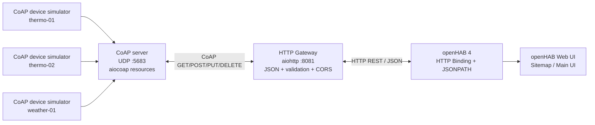

## Архітектура



Потік: openHAB HTTP Binding робить GET до Gateway → Gateway виконує CoAP GET до ресурсу → CoAP-відповідь перетворюється на JSON envelope → JSONPATH дістає значення → Item оновлюється в openHAB.


## HTTP REST API

Base URL: `http://localhost:8081`

| Method | Endpoint | Призначення |
|---|---|---|
| GET | `/api/health` | Стан Gateway |
| GET | `/api/devices` | Список пристроїв та ресурсів |
| GET | `/api/devices/{id}/resources/{resource}` | CoAP GET |
| POST | `/api/devices/{id}/resources/{resource}` | CoAP POST |
| PUT | `/api/devices/{id}/resources/{resource}` | CoAP PUT |
| DELETE | `/api/devices/{id}/resources/{resource}` | CoAP DELETE |

Доступні ID: `thermo-01`, `thermo-02`, `weather-01`.
Ресурси: `temperature`, `humidity`, `status`. Додатковий CoAP resource `/large` повертає великий
JSON payload для демонстрації Block2.

### Приклади PowerShell

```powershell
# GET
Invoke-RestMethod http://localhost:8081/api/devices/thermo-01/resources/temperature

# PUT
$body = @{ value = 26.5 } | ConvertTo-Json
Invoke-RestMethod -Method Put -Uri http://localhost:8081/api/devices/thermo-01/resources/temperature -ContentType "application/json" -Body $body

# POST
$body = @{ value = 48 } | ConvertTo-Json
Invoke-RestMethod -Method Post -Uri http://localhost:8081/api/devices/thermo-01/resources/humidity -ContentType "application/json" -Body $body

# DELETE (видалити ресурс до перезапуску контейнера)
Invoke-RestMethod -Method Delete http://localhost:8081/api/devices/thermo-02/resources/humidity
```

Для GET відповідь має форму:
```json
{
  "deviceId": "thermo-01",
  "resource": "temperature",
  "coapCode": "2.05 Content",
  "data": {"value": 22.4, "unit": "°C"},
  "timestamp": "..."
}
```

## HTTP status mapping

| CoAP result | HTTP |
|---|---:|
| 2.01 Created | 201 |
| 2.02 Deleted | 200 |
| 2.04 Changed / 2.05 Content | 200 |
| 4.00 Bad Request | 400 |
| 4.01 Unauthorized | 401 |
| 4.03 Forbidden | 403 |
| 4.04 Not Found | 404 |
| 4.05 Method Not Allowed | 405 |
| 4.06 Not Acceptable | 406 |
| 4.13 Request Entity Too Large | 413 |
| 4.15 Unsupported Content Format | 415 |
| 5.xx Server errors | відповідний 5xx, невідомий код → 502 |
| CoAP timeout | 504 |
| CoAP transport failure | 502 |

## Data transformation та безпека даних

- CoAP resource відповідає JSON; Gateway декодує payload і формує стабільний envelope.
- Для POST/PUT дозволений `application/json` (або `application/merge-patch+json`).
- Для відповіді підтримується `Accept: application/json` або `*/*`; інші типи отримують 406.
- Payload обмежений 64 KiB, JSON має бути об'єктом, NaN/Infinity відхиляються.
- Значення temperature обмежені -50…100 °C, humidity та battery — 0…100.
- Ідентифікатори проходять whitelist-перевірку; довільний шлях до CoAP URI не приймається.
- CORS для навчального стенда відкритий (`*`); у production потрібно обмежити origin.

## Error handling та logging

- CoAP client має timeout 3 секунди.
- До 3 спроб; exponential backoff: 250 ms → 500 ms.
- Timeout повертає HTTP 504, транспортна помилка — 502.
- CoAP 4.xx/5.xx мапляться у відповідні HTTP статуси; помилки записуються через Python logging.
- openHAB HTTP Thing має `strictErrorHandling=true`, тому невдала перевірка переводить Thing в OFFLINE.
- openHAB rule записує зміну статусу Thing у журнал.

Перегляд логів:
```powershell
docker compose logs -f coap-gateway
docker compose logs -f openhab
```

## Тестові сценарії

1. `GET /api/health` → HTTP 200.
2. `GET /api/devices` → 3 пристрої.
3. GET temperature → JSON з `data.value`.
4. PUT temperature зі значенням 26.5 → HTTP 200; повторний GET повертає 26.5.
5. PUT humidity зі значенням 150 → CoAP 4.00 → HTTP 400.
6. GET неіснуючого device/resource → HTTP 404.
7. POST з `Content-Type: text/plain` → HTTP 415.
8. GET з `Accept: text/plain` → HTTP 406.
9. DELETE існуючого ресурсу → HTTP 200; повторний GET → HTTP 404.
10. GET `coap://localhost:5683/large` CoAP-клієнтом → великий payload (Block2).
11. Перевірити openHAB Items та Sitemap після запуску; значення мають оновлюватися приблизно кожні 5 секунд.

